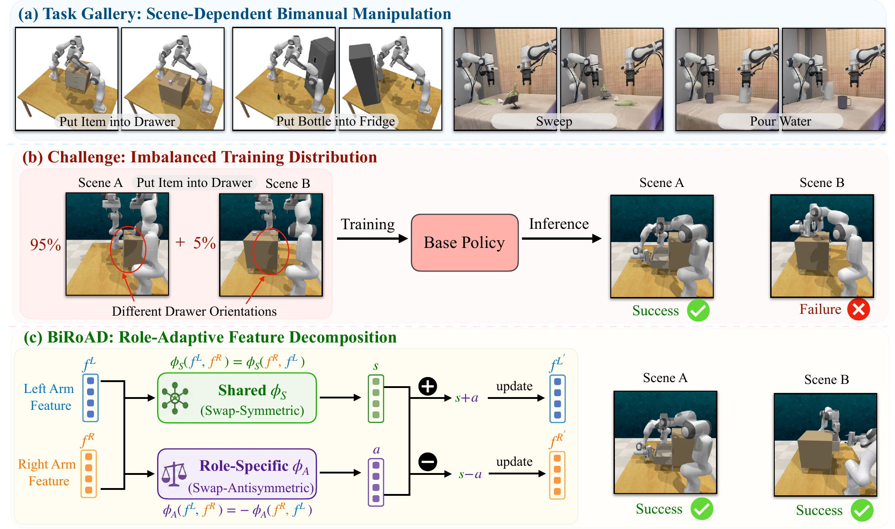

# BiRoAD: Learning Shared and Role-Adaptive Representations for Bimanual Manipulation

**CoRL 2026**

**[Project page](https://sxy7147.github.io/biroad-website/) · [Paper](https://sxy7147.github.io/biroad-website/assets/paper/biroad.pdf) · [Video and real-world demonstrations](https://sxy7147.github.io/biroad-website/#overview)**



This repository provides the **3D FlowMatch Actor (3DFA) implementation of BiRoAD**, with tools for data preprocessing, training, and online inference in RLBench. Pretrained checkpoints are available [below](#pretrained-checkpoints). Test data is available in the [evaluation section](#inference-and-online-evaluation).

## Installation

Use a Linux machine with an NVIDIA GPU. Run all commands from the repository root in **Bash**.

```bash
conda create -n biroad python=3.10 -y
conda activate biroad

# Install a CUDA-enabled PyTorch build and its matching torchvision version.
python -m pip install torch torchvision
python -m pip install numpy pillow einops tqdm "transformers<5" \
    "zarr<3" numcodecs diffusers kornia tensorboard natsort "imageio[ffmpeg]"
python -m pip install git+https://github.com/openai/CLIP.git
python -m pip install -e .
mkdir -p ../hf_cache
```

Use `zarr<3` for compatibility with the dataset loader. Install CLIP from the GitHub repository shown above.

The visual backbone loads CLIP RN50, and the text encoder loads `openai/clip-vit-base-patch32`. The training and evaluation scripts use `../hf_cache` and enable offline mode by default. Before the first run, set `HF_HUB_OFFLINE=0` and `TRANSFORMERS_OFFLINE=0` inside those scripts to download missing weights and tokenizer files. Adjust `HF_HOME` for a different cache location, and set `HF_ENDPOINT=https://huggingface.co` if you do not use the configured mirror. Enable offline mode after the cache is populated.

### RLBench simulation environment

Training from Zarr data does not require RLBench. For raw-data conversion and online evaluation, use [BiRoad_Tasks](https://github.com/Tracywhy/BiRoad_Tasks), which provides the bimanual RLBench runtime, matching PyRep fork, and all 16 evaluation task definitions and scene models.

Install it into the same `biroad` environment created above. From this repository root:

```bash
conda activate biroad
git clone https://github.com/Tracywhy/BiRoad_Tasks.git ../BiRoad_Tasks
PYTHON_BIN=python bash ../BiRoad_Tasks/scripts/setup_environment.sh
source ../BiRoad_Tasks/scripts/env.sh
```

See the [task-suite installation guide](https://github.com/Tracywhy/BiRoad_Tasks#installation) for system prerequisites, CoppeliaSim 4.1 and headless rendering. Use the existing Python 3.10 environment here instead of creating the guide's separate Python 3.8 environment. The setup script installs the bundled RLBench/PyRep packages and downloads CoppeliaSim if needed. The evaluation scripts also require `xvfb-run`; source `../BiRoad_Tasks/scripts/env.sh` in each new shell before conversion or evaluation.

## Data preparation

### Task list

The data preprocessing, training, and evaluation scripts use the following 16 task variants. The order below defines the task-ID mapping used by conversion and training. The `_symmetric` marker is a legacy task identifier for the role-swapped configuration described in the paper.

```bash
all_tasks=(
    bimanual_handover_item_easy_random
    bimanual_handover_item_easy_symmetric_random
    bimanual_pick_laptop_random
    bimanual_pick_laptop_symmetric_random
    bimanual_pick_plate_random
    bimanual_pick_plate_symmetric_random
    bimanual_put_bottle_in_fridge
    bimanual_put_bottle_in_fridge_symmetric
    bimanual_put_item_in_drawer_random
    bimanual_put_item_in_drawer_symmetric_random
    bimanual_sweep_to_dustpan_random
    bimanual_sweep_to_dustpan_symmetric_random
    bimanual_take_tray_out_of_oven
    bimanual_take_tray_out_of_oven_symmetric
    coordinated_take_shoes_out_of_box
    coordinated_take_shoes_out_of_box_symmetric
)
```

### Convert raw demonstrations

Generate raw training and validation demonstrations with the [BiRoad_Tasks dataset generator](https://github.com/Tracywhy/BiRoad_Tasks#dataset-generation), or use existing demonstrations with matching task definitions. The preprocessing script converts these demonstrations to Zarr for training. Arrange disjoint training, validation, and test episodes as follows:

```text
data/
├── raw/train/<task>/all_variations/episodes/<episode>/
├── raw/val/<task>/all_variations/episodes/<episode>/
└── test_raw/<task>/all_variations/episodes/<episode>/
```

For conversion, each episode contains `low_dim_obs.pkl`, `variation_number.pkl`, `variation_descriptions.pkl`, and the RGB/depth folders for `front`, `wrist_left`, and `wrist_right`. Images must match `im_size` (128 × 128 in the script); the converter does not resize them. See [peract2_to_zarr.py](data_processing/peract2_to_zarr.py) for filenames and camera metadata.

Use [run_peract2_role_adaptation_to_zarr.sh](data_processing/run_peract2_role_adaptation_to_zarr.sh). Set `original_count` and `role_swapped_count` inside the script to **95 / 5** and run it, then change them to **50 / 50** and run again:

```bash
bash data_processing/run_peract2_role_adaptation_to_zarr.sh
```

Each run converts **both train and val** for all listed tasks, using the same episode counts for both splits. Ensure enough raw episodes exist and check the reported counts.

Each ratio directory under `data/zarr_datasets/` contains `train.zarr`, `val.zarr`, and `instructions.json`. The training scripts use:

- `ratio_95_5/train.zarr` and `ratio_95_5/instructions.json` for training.
- `ratio_50_50/val.zarr` and `ratio_50_50/instructions.json` for validation.

Skip conversion if these files are already available. Test episodes are read directly during online inference and do not need Zarr conversion or pre-rendered RGB/depth images.

**Keep the task-ID mapping consistent.** The training scripts' `all_tasks` must preserve the conversion order. Older Zarr datasets may use a different mapping; regenerate them with the current converter, or restore their original `all_tasks` mapping before reuse.

## Training

Use the [BiRoAD training script](scripts/rlbench/train_biroad_95_5.sh) or [3DFA baseline script](scripts/rlbench/train_3dfa_95_5.sh). Both train on the 95/5 split and validate on the 50/50 split. For example:

```bash
CUDA_VISIBLE_DEVICES=0,1 bash scripts/rlbench/train_biroad_95_5.sh
```

Choose your GPU IDs with `CUDA_VISIBLE_DEVICES`, and adjust the data paths and per-GPU batch size `B` inside the script. By default, `B = 256 / ngpus` (128 with two GPUs). Reduce `num_workers` or `memory_limit` if host memory is limited.

Checkpoints are saved to `train_logs/<main_dir>/<run_log_dir>/`: `last.pth` is used to resume training automatically when present, and `best.pth` is used for inference. Change `main_dir` to start a separate experiment. Monitor with `tensorboard --logdir train_logs`.

## Pretrained checkpoints

Download the checkpoints (~422 MB each) and `SHA256SUMS.txt` from [Google Drive](https://drive.google.com/drive/folders/1Dl1djKwliIzvr6e9Z4sc8M0vcxQOYGf1). Ratios refer to original / role-swapped training demonstrations.

| Model | Ratio | Checkpoint |
| --- | --- | --- |
| BiRoAD | 95/5 | [biroad_95_5.pth](https://drive.google.com/file/d/1a_zH-hwVV9TWeAfjBtulbAcIrOJ7aFs-/view?usp=drive_link) |
| 3DFA | 95/5 | [3dfa_95_5.pth](https://drive.google.com/file/d/1pl9KqXjeb99AUqhtD-VbxeUUM4PAKrLv/view?usp=drive_link) |
| BiRoAD | 50/50 | [biroad_50_50.pth](https://drive.google.com/file/d/1YZ8Durh9STl9qLVq3x4UWZwaBVWFOGe_/view?usp=drive_link) |
| 3DFA | 50/50 | [3dfa_50_50.pth](https://drive.google.com/file/d/1kJL8a4WKBjtFF5-zqv6oXln2x0xALTsu/view?usp=sharing) |

Save the selected file under `checkpoints/` and set `checkpoint` in the matching evaluation script to its path (e.g. `checkpoint=./checkpoints/biroad_95_5.pth`). Use `eval_biroad.sh` for BiRoAD and `eval_3dfa.sh` for 3DFA; give each evaluation a distinct `exp` label.

## Inference and online evaluation

Download the [test dataset](https://drive.google.com/file/d/1hxFM-XP5-UU_mbfpmzjOP_PWP798p9AE/view?usp=drive_link) (~160 MB; [ZIP and checksum folder](https://drive.google.com/drive/folders/1KzHMAFeFOLEq5ZFY2RC0iXrCamUK565s)): **16 task variants × 50 episodes = 800 episodes**. This evaluation-only package contains state/variation files, a task manifest and checksums; it has no RGB/depth images.

Extract the ZIP and place its `test/` directory at `data/test_raw/`, so tasks are directly under `data/test_raw/<task>/all_variations/episodes/`. Keep `num_demos=50` and install the [BiRoad_Tasks environment](#rlbench-simulation-environment) above before evaluation.

Use the [BiRoAD evaluation script](online_evaluation_rlbench/scripts/eval_biroad.sh) or [3DFA baseline script](online_evaluation_rlbench/scripts/eval_3dfa.sh), with test demonstrations under `data/test_raw/`. The evaluator restores each test scene and executes predicted actions in RLBench. For example:

```bash
CUDA_VISIBLE_DEVICES=0 N_WORKERS=1 bash online_evaluation_rlbench/scripts/eval_biroad.sh
```

Before running, verify `checkpoint` and set `exp` and `B` to match training. Model settings must also match the checkpoint. Adjust `data_dir` and `num_demos` for your test data; set `save_video=false` if videos are unnecessary.

Results are saved under `eval_logs/<exp>/<checkpoint_alias>/seed<seed>/`, including per-task `eval.json`, videos when enabled, and an automatically generated `all_results.txt` summary. Check that all selected tasks completed before using the average; episodes that cannot be reset are excluded from the evaluated count.

## Citation

```bibtex
@inproceedings{shen2026biroad,
  title = {{BiRoAD}: Learning Shared and Role-Adaptive Representations for Bimanual Manipulation},
  author = {Shen, Yan and Liu, Yuchen and Jiang, Feng and Hu, Hangtian and Li, Xiaoqi and Chen, Shu and Wu, Ruihai and Dong, Hao},
  booktitle = {Proceedings of the Conference on Robot Learning (CoRL)},
  year = {2026}
}
```

## Acknowledgements and license

This implementation builds on [3D FlowMatch Actor](https://github.com/nickgkan/3d_flowmatch_actor) and its [paper](https://arxiv.org/abs/2508.11002), with components adapted from [3D Diffuser Actor](https://github.com/nickgkan/3d_diffuser_actor). The simulation setup builds on [PerAct2](https://github.com/markusgrotz/peract_bimanual) and [RLBench](https://github.com/markusgrotz/RLBench). We thank the authors for making their work available.

The repository retains the upstream [MIT license and copyright notice](LICENSE).
